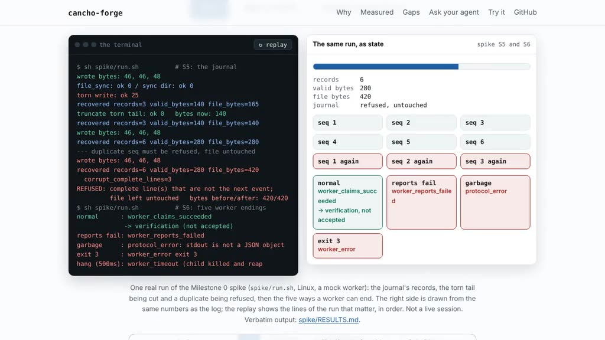

# cancho-forge

**An agent-run software company you can audit.**

Agent workflows have capable workers and no durable operating system around
them: plans disappear into chats, a worker is often the only judge of its own
work, and limits live in prompts. cancho-forge is the missing company-level
runtime. State, budgets, approvals and evidence are kept by the runtime, and a
worker such as [cancho-code](https://github.com/alpibrusl/cancho-code) only
proposes and executes.

```
[WORKER]          mock         running
  normal          worker_claims_succeeded   -> verification (not accepted)
  hang (500 ms)   worker_timeout            child killed and reaped
[AUTHORITY]       dispatcher   exec("/tmp/cancho-forge-spike/bin")   no filesystem, no network
```

[](docs/demo/forge-demo.mp4)
*A 28-second recording of the project page's replay of a real run, not a live session. Re-record it with `node scripts/record-demo.js` (needs `playwright` and `ffmpeg`).*

- **A worker cannot accept its own work.** A reported success only moves a task
  to verification. Acceptance needs checks Forge ran itself.
- **Authority is a capability, not a request.** Each worker is given an `Exec`
  narrowed to its own programs; `cancho authority` prints what the dispatcher
  and the worker can reach.
- **One append-only journal.** Recovery cuts only a torn last line, and refuses,
  changing nothing, when a complete line is wrong.
- **Loops and workers stop.** Deadlines and output bounds end a hung or
  runaway worker, named, and the child is reaped.
- **Written entirely in [cancho](https://github.com/alpibrusl/cancho).** No
  Python, no Rust and no shell in the product.
- **Measured, at Milestone 0** (Linux x86_64, a mock worker): a 300 ms deadline
  ended in 301 ms; a runaway output was stopped at exactly 1,000 bytes; a torn
  journal tail was cut from 165 to 140 bytes and a second recovery changed
  nothing; five ways of a worker ending were each classified. Conditions and
  caveats: [`spike/RESULTS.md`](spike/RESULTS.md).
- **What exists now (Milestone 1's core, nothing more).** A task state
  machine with 18 legal edges and twelve named refusals; a journal that replays
  into task state, cuts only a torn tail, and refuses (changing nothing) on a
  corrupt complete line; snapshots that agree with the journal or are refused
  (snapshot plus tail equals a full replay, tested after every prefix); the
  single-writer lock; a read-only `forge status` and `forge history`; 82 unit
  tests, 62 file cases, and a program that kills a writer with
  `child_kill_group` at each of 25 crash points of append, sync, snapshot and
  rename and recovers (420 checks), all in the gate. A process kill is not a
  power loss: that is not tested. Not done: objectives and artifacts, segments,
  any worker adapter, policy, budgets, verification. **Nothing here runs a company yet.** Not measured:
  macOS, a real cancho-code run with a model, several workers at once, power
  loss. The Cancho Code interface was audited, not exercised with a model:
  [`docs/cancho-code-audit.md`](docs/cancho-code-audit.md).

**[Project page](https://alpibrusl.github.io/cancho-forge)** ·
[Architecture](docs/architecture.md) ·
[Worker contract](docs/worker-contract.md) ·
[Cancho Code audit](docs/cancho-code-audit.md) ·
[Roadmap](docs/roadmap.md)

## Try it

**Claude Code skill:** copy [`skills/cancho-forge`](skills/cancho-forge/SKILL.md) into `~/.claude/skills/` (or your project's `.claude/skills/`) and the agent knows how to run the gate, read the spikes and extend Forge with the rules built in. Other agents can read the same file as plain instructions.

**Or ask your coding agent to do it:** paste [`docs/agent-prompt.md`](docs/agent-prompt.md) into Claude Code, Codex or similar. It installs the pinned compiler, proves the install with the gate (no network, no key, no model) and runs the spikes.

You need the [cancho](https://github.com/alpibrusl/cancho) compiler, at the
revision named in `cancho.toml`, and `clang`.

```sh
git clone https://github.com/alpibrusl/cancho-forge.git && cd cancho-forge
export CANCHO=<path-to-the-cancho-binary>
scripts/gate.sh        # fmt --check, check, test, file conformance, kill at every crash point, CLI, authority, file budget  ->  gate: PASS
spike/run.sh           # re-runs every spike and prints the evidence
```

Read [`spike/RESULTS.md`](spike/RESULTS.md) first: it lists what cancho cannot
do yet that shapes the later milestones (grants fixed at build time, cancho
#534; a bound violation that traps, #535; orphaned workers after a crash). A
kill that reached one pid was one of them: it is built (cancho #533) and the
spike now passes without `/bin/kill`.

## More

[Threat model](docs/threat-model.md) · [Architecture](docs/architecture.md) ·
[Worker contract](docs/worker-contract.md) · [Roadmap](docs/roadmap.md) ·
[Working rules](CLAUDE.md)

EUPL-1.2.
